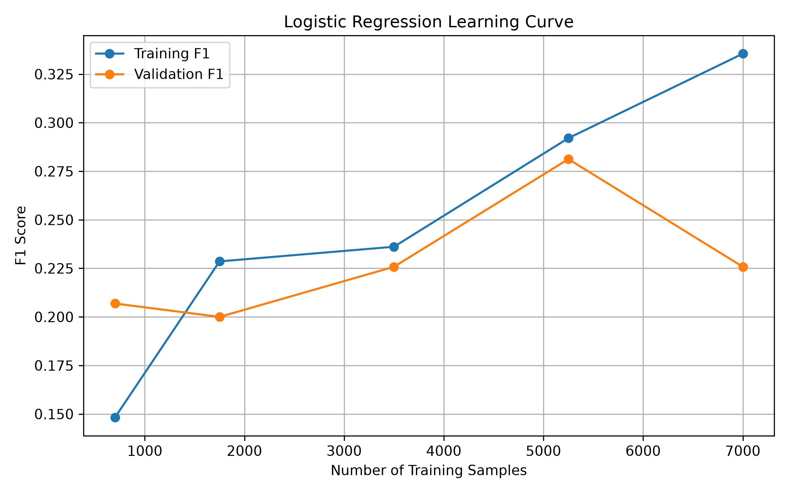
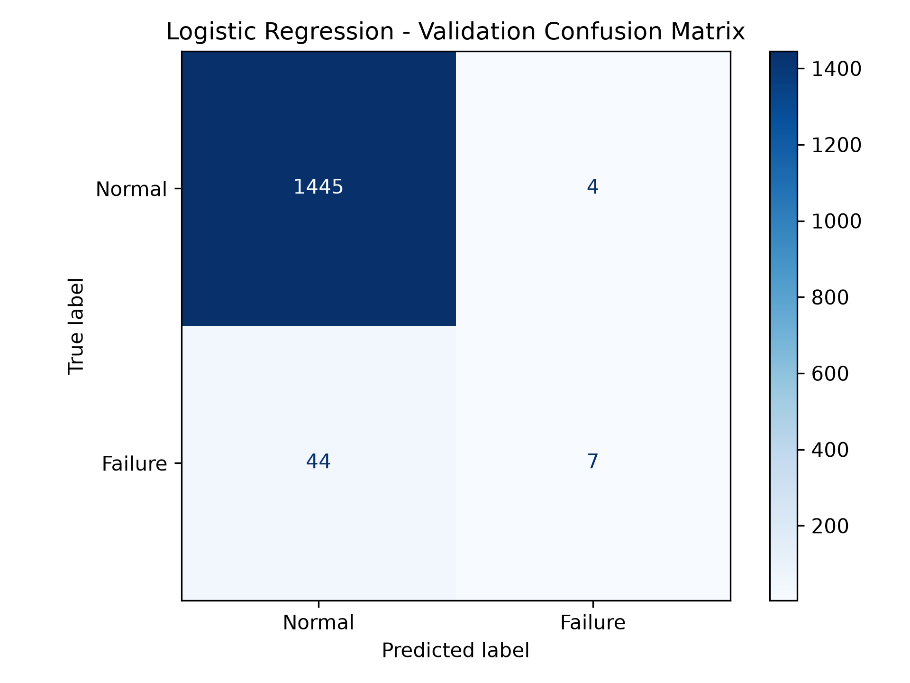

# Machine Health Monitoring AI

**Course:** ARTE 4110U - Deep Learning Architecture and Algorithms  
**University:** Ontario Tech University  
**Team Members:** Rayyan Aseef, Aditya Ravi, Shayaan Kashif  

## Project Overview

This project aims to predict machine failures using operating sensor measurements. Unexpected machine failures can lead to production downtime, equipment damage, and increased maintenance costs.

We use the AI4I 2020 Predictive Maintenance Dataset to classify machine conditions as either normal operation (0) or machine failure (1).

Our baseline model uses logistic regression, which will be compared against a PyTorch multilayer perceptron (MLP).

## Dataset

**Dataset:** AI4I 2020 Predictive Maintenance Dataset  
**Source:** https://archive.ics.uci.edu/dataset/601/ai4i+2020+predictive+maintenance+dataset  
**License:** CC BY 4.0  

The dataset contains 10,000 observations:

- 9,661 normal observations (96.61%)
- 339 failure observations (3.39%)
- No missing values
- No duplicate rows

### Input Features

The model uses the following features:

1. Machine type
2. Air temperature (K)
3. Process temperature (K)
4. Rotational speed (rpm)
5. Torque (Nm)
6. Tool wear (min)

### Removed Features

The following columns are removed:

- `UDI` and `Product ID`: Identifiers
- `TWF`, `HDF`, `PWF`, `OSF`, `RNF`: Failure-type labels that could cause data leakage

### Dataset Splitting

We use stratified sampling with `random_state=42` to maintain the class distribution across the datasets.

| Split | Samples | Normal | Failure |
|---|---:|---:|---:|
| Training | 7,000 | 6,763 | 237 |
| Validation | 1,500 | 1,449 | 51 |
| Testing | 1,500 | 1,449 | 51 |

### Preprocessing

- StandardScaler standardizes the five numerical features.
- OneHotEncoder converts the categorical machine type into numerical features.
- All preprocessing transformations are fitted only on the training dataset.
- The same transformations are applied to validation and testing datasets.

After preprocessing, each observation contains eight numerical input features.

## Project Structure

```text
machine-health-monitoring/
├── data/
│   └── raw/
│       └── ai4i2020.csv
├── src/
│   ├── data.py
│   ├── models.py
│   ├── train.py
│   └── evaluate.py
├── experiments/
│   └── logistic_regression/
│       ├── params.json
│       ├── metrics.json
│       ├── learning_curve.json
│       ├── learning_curve.png
│       ├── train.log
│       ├── evaluation.json
│       └── confusion_matrix.png
├── checkpoints/
│   ├── logistic_regression.joblib
│   └── preprocessor.joblib
├── requirements.txt
├── README.md
├── CONTRIBUTIONS.md
└── .gitignore
```

The raw dataset and saved model files are excluded from Git and can be obtained or regenerated using the instructions below.

## Installation

### 1. Clone the Repository

```bash
git clone <repository-url>
cd machine-health-monitoring
```

### 2. Create a Virtual Environment

```bash
python3 -m venv .venv
source .venv/bin/activate
```

### 3. Install Dependencies

```bash
python -m pip install -r requirements.txt
```

The project uses:

- Python
- pandas
- NumPy
- scikit-learn
- PyTorch
- Matplotlib
- joblib

### 4. Download the Dataset

Download the AI4I 2020 Predictive Maintenance Dataset from:

https://archive.ics.uci.edu/dataset/601/ai4i+2020+predictive+maintenance+dataset

Place the CSV file in:

```text
data/raw/ai4i2020.csv
```

Ensure the filename is exactly `ai4i2020.csv`.

## Running the Project

Run all commands from the project root directory.

### 1. Dataset Preparation

```bash
python3 src/data.py
```

This script:

- Loads the dataset
- Displays dataset information and statistics
- Checks missing values and duplicates
- Examines class distribution
- Removes irrelevant and leakage columns
- Creates reproducible training, validation and testing splits
- Applies encoding and standardization

### 2. Train Logistic Regression

```bash
python3 src/train.py
```

This script:

- Loads and preprocesses the dataset
- Trains the logistic regression baseline
- Evaluates the model using validation data
- Generates a learning curve
- Saves the trained model and preprocessor
- Records experiment settings, metrics and logs

### 3. Evaluate the Saved Model

```bash
python3 src/evaluate.py
```

This script:

- Loads the saved logistic regression model
- Loads the saved preprocessing pipeline
- Recreates the dataset splits
- Evaluates the validation dataset
- Generates a classification report
- Saves a confusion matrix
- Saves evaluation metrics

The training script must be executed before evaluation to generate the saved model files.

## Logistic Regression Baseline

We implemented logistic regression using scikit-learn.

### Model Configuration

| Parameter | Value |
|---|---|
| Model | Logistic Regression |
| Maximum iterations | 1,000 |
| Random seed | 42 |
| Class weighting | None |
| Classification threshold | 0.5 |
| Input features | 8 |

### Validation Results

| Metric | Result |
|---|---:|
| Precision | 0.636364 |
| Recall | 0.137255 |
| F1 Score | 0.225806 |
| Average Precision | 0.384380 |

### Confusion Matrix

| Actual / Predicted | Normal | Failure |
|---|---:|---:|
| Normal | 1,445 | 4 |
| Failure | 44 | 7 |

The baseline correctly identified 7 of the 51 machine failures in the validation dataset.

Although precision is relatively high, recall is low. This means that the model misses many actual machine failures.

### Learning Curve

We generated a learning curve using five different training set sizes:

- 10%
- 25%
- 50%
- 75%
- 100%

The curve compares training and validation F1 scores.



### Confusion Matrix Visualization



## Experiment Tracking

All logistic regression experiment results are stored in:

```text
experiments/logistic_regression/
```

Files include:

| File | Description |
|---|---|
| `params.json` | Model configuration and random seed |
| `metrics.json` | Validation metrics from training |
| `learning_curve.json` | Learning curve values |
| `learning_curve.png` | Training and validation F1 graph |
| `train.log` | Training run summary |
| `evaluation.json` | Independent validation results |
| `confusion_matrix.png` | Validation confusion matrix |

The trained model and preprocessor are saved in:

```text
checkpoints/
```

These files can be regenerated by executing `src/train.py`.

## Proposed Deep Learning Model

The proposed neural network is a feedforward multilayer perceptron implemented using PyTorch.

### Architecture

- Input layer: 8 features
- Hidden layer 1: 64 neurons with ReLU
- Hidden layer 2: 32 neurons with ReLU
- Output layer: 1 neuron

The network contains approximately 2,689 trainable parameters.

### Planned Training Configuration

- Optimizer: Adam
- Loss function: BCEWithLogitsLoss
- Task: Binary classification
- Dataset splits: Same as logistic regression

The MLP will be evaluated using the same metrics as the baseline.

## Planned Experiments

### Class Weighting

Because the dataset is heavily imbalanced, we plan to investigate whether class weighting improves failure detection.

We will compare:

1. Training without class weighting
2. Training with class weighting

Other training settings will remain consistent for a controlled comparison.

We will evaluate changes in:

- Precision
- Recall
- F1 score
- Average precision

## Limitations

The dataset is synthetic and may not represent real industrial operating conditions.

Machine failures account for only 3.39% of observations, which makes failure detection challenging.

The logistic regression baseline uses a linear decision boundary and may not capture complex relationships between operating measurements.

## Reproducibility

To reproduce the baseline results:

1. Install the required dependencies.
2. Download and place the dataset in `data/raw/`.
3. Run `python3 src/train.py`.
4. Run `python3 src/evaluate.py`.
5. Compare the generated metrics with the validation results above.

The project uses a fixed random seed and stratified dataset splitting.

Preprocessing is fitted only on the training data to prevent leakage.

Experiment parameters, metrics and logs are saved for reproducibility.

The testing dataset is reserved for the final model evaluation.

## Team Contributions

- **Rayyan Aseef:** Dataset loading, exploratory data analysis, feature selection, splitting and preprocessing.
- **Aditya Ravi:** Logistic regression model implementation, training pipeline, checkpoints, experiment logging and learning curves.
- **Shayaan Kashif:** Model evaluation, classification metrics, confusion matrix and independent validation.

Detailed contributions are documented in `CONTRIBUTIONS.md`.

## References

[1] UCI Machine Learning Repository, "AI4I 2020 Predictive Maintenance Dataset," 2020.  
DOI: https://doi.org/10.24432/C5HS5C
